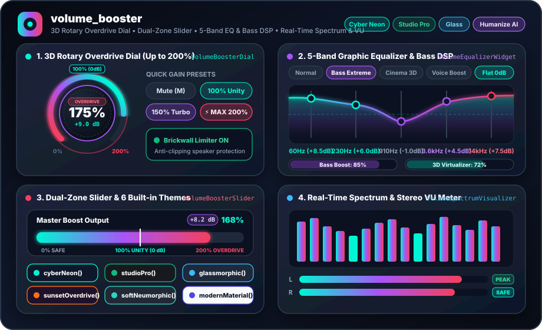
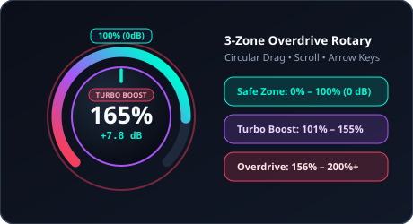
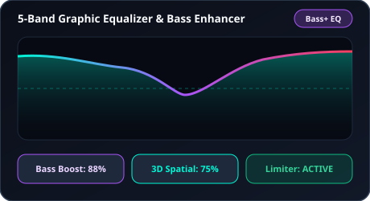
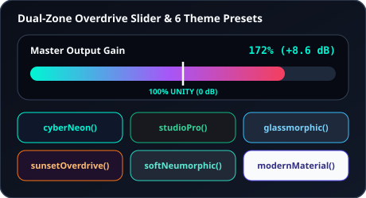
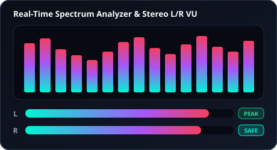

# volume_booster

<p align="center">
  <a href="https://pub.dev/packages/volume_booster">
    
  </a>
</p>

[](https://pub.dev/packages/volume_booster)
[](https://opensource.org/licenses/MIT)
[](https://flutter.dev)
[](https://pub.dev/packages/volume_booster)
[](https://humanize.id)

A modern, super eye-catching, and customizable Flutter volume booster and audio gain amplifier widget library featuring 3D rotary overdrive dials (up to `200%+` / `+18 dB`), dual-zone segmented LED sliders with `100% (0 dB)` unity markers, a 5-band graphic equalizer with live cubic-Bezier frequency response curves, Bass Boost & 3D Virtualizer enhancers, Brickwall Anti-Clipping Safety Limiter, real-time stereo L/R VU peak meters, and 6 studio theme presets. Zero external dependencies and full cross-platform support.

> 🌟 Supported & Powered by [Humanize AI](https://humanize.id)

<p align="center">
  
</p>

---

## 🎬 Live Animated UI Preview

| 1. 3D Rotary Overdrive Dial (`VolumeBoosterDial`) | 2. 5-Band Graphic Equalizer & DSP (`VolumeEqualizerWidget`) |
| :---: | :---: |
|  |  |
| Segmented 3-zone LED ring (`Safe 0–100%`, `Turbo 101–155%`, `Overdrive 156–200%+`), pulsing harmonic wave rings, live dB badge, and quick-jump presets. | Real-time cubic-Bezier frequency response curve across `60Hz` – `14kHz`, preset chips, Bass Boost, 3D Virtualizer, and Brickwall Safety Limiter. |

| 3. Dual-Zone Slider & 6 Themes (`VolumeBoosterSlider`) | 4. Real-Time Spectrum & Stereo VU (`VolumeSpectrumVisualizer`) |
| :---: | :---: |
|  |  |
| Clear `100% (0 dB)` unity gain divider separating standard hardware volume from software boost overdrive across 6 built-in theme presets. | 20-band frequency spectrum analyzer (`LED Bars`, `Harmonic Wave`, `Dual Mirror`) paired with Stereo L/R peak-hold VU meters and `CLIP` indicators. |

---

## ✨ Key Features

- 🎛️ **3D Rotary Overdrive Boost Dial** (`VolumeBoosterDial`):
  - Segmented outer LED tick ring with automatic 3-zone color transitions:
    - **Safe Zone (`0% – 100%` / `<= 0.0 dB`)** — Clean unity output.
    - **Turbo Boost Zone (`101% – 155%` / `+0.1 dB to +6.6 dB`)** — Enhanced pre-amp clarity.
    - **Overdrive Zone (`156% – 200%+` / `> +6.6 dB`)** — Maximum amplification with pulsing harmonic energy rings.
  - Multi-modal interaction: circular touch/mouse drag, tap-to-angle, mouse scroll wheel, and keyboard shortcuts (`ArrowUp`, `ArrowDown`, `ArrowLeft`, `ArrowRight`, `M` to mute).
  - Quick-jump preset pill bar (`Mute`, `100%`, `150%`, `MAX 200%`).
- 🎚️ **Dual-Zone Overdrive Slider** (`VolumeBoosterSlider`):
  - Distinct `100% (0 dB)` unity gain boundary line separating base hardware volume from software boost gain.
  - Choose between discrete segmented LED blocks (`segmentedLedTrack: true`) or a smooth neon gradient bar.
- 📈 **5-Band Graphic Equalizer & Acoustic Enhancers** (`VolumeEqualizerWidget`):
  - Smooth cubic-Bezier spline frequency response curve drawn behind interactive vertical band faders (`60Hz`, `230Hz`, `910Hz`, `3.6kHz`, `14kHz`, `-12 dB` to `+12 dB`).
  - 7 built-in acoustic presets (`VolumePreset.normal`, `voiceBoost`, `bassExtreme`, `cinema3D`, `gaming`, `maxOverdrive`, `nightLimiter`).
  - Integrated **Bass Boost** (`0–100%`), **3D Spatial Virtualizer** (`0–100%`), and **Brickwall Anti-Clipping Limiter** toggle.
- 📊 **Real-Time Spectrum Analyzer & Stereo L/R VU Meters** (`VolumeSpectrumVisualizer` & `StereoVuMeter`):
  - Three visual modes: `VisualizerMode.ledBars`, `VisualizerMode.smoothWave`, and `VisualizerMode.dualMirror`.
  - Dual-channel Left/Right VU LED meters with peak-hold markers and real-time `CLIP` / `OK` status lamps.
- 🎨 **6 Built-in Studio Theme Presets** (`VolumeBoosterStyle`):
  - `VolumeBoosterStyle.cyberNeon()` — Obsidian cyber deck with electric cyan, neon violet, and crimson overdrive bloom.
  - `VolumeBoosterStyle.studioPro()` — Brushed gunmetal mastering rack with emerald, warm amber, and ruby peak LEDs.
  - `VolumeBoosterStyle.glassmorphic()` — Translucent frosted glass panel with luminous sky-to-indigo accents.
  - `VolumeBoosterStyle.sunsetOverdrive()` — High-energy gold, orange, and magenta plasma palette.
  - `VolumeBoosterStyle.softNeumorphic()` — Tactile soft-UI console with recessed fader wells.
  - `VolumeBoosterStyle.modernMaterial()` — Crisp Material 3 light surface for daytime media apps.
- 🧠 **Reactive Controller & Optional Platform Bridge** (`VolumeBoosterController`):
  - Programmatic control over volume, boost multiplier, mute memory, EQ bands, presets, and real-time audio frame ingestion (`updateAudioFrame`).

---

## 📦 Installation

Add `volume_booster` to your `pubspec.yaml`:

```yaml
dependencies:
  volume_booster: ^1.0.1
```

Or install via the Flutter CLI:

```bash
flutter pub add volume_booster
```

---

## 🚀 Quick Start

### 1. All-in-One Studio Console (`VolumeBoosterConsole`)

```dart
import 'package:flutter/material.dart';
import 'package:volume_booster/volume_booster.dart';

class StudioBoosterScreen extends StatefulWidget {
  const StudioBoosterScreen({super.key});

  @override
  State<StudioBoosterScreen> createState() => _StudioBoosterScreenState();
}

class _StudioBoosterScreenState extends State<StudioBoosterScreen> {
  final controller = VolumeBoosterController(
    initialVolume: 1.45, // 145% Turbo Boost (+5.4 dB)
    maxBoostMultiplier: 2.0, // Up to 200% (+12.0 dB)
  );

  @override
  void dispose() {
    controller.dispose();
    super.dispose();
  }

  @override
  Widget build(BuildContext context) {
    return Scaffold(
      backgroundColor: const Color(0xFF070A12),
      body: SingleChildScrollView(
        padding: const EdgeInsets.all(16),
        child: VolumeBoosterConsole(
          controller: controller,
          style: VolumeBoosterStyle.cyberNeon(),
          autoAnimateVisualizer: true,
          onVolumeChanged: (effectiveVolume) {
            debugPrint(
              'Output: ${controller.effectivePercentage}% (${controller.formattedDecibels})',
            );
          },
        ),
      ),
    );
  }
}
```

---

## 📖 Component Usage Examples

### 2. Standalone 3D Rotary Overdrive Dial (`VolumeBoosterDial`)

```dart
VolumeBoosterDial(
  initialVolume: 1.65, // 165% (+7.8 dB)
  maxBoostMultiplier: 2.0,
  size: 240,
  style: VolumeBoosterStyle.sunsetOverdrive(),
  showQuickButtons: true,
  showDecibelBadge: true,
  showSafetyBadge: true,
  onChanged: (volume) {
    debugPrint('Rotary boost multiplier: $volume');
  },
)
```

### 3. Dual-Zone Overdrive Slider (`VolumeBoosterSlider`)

```dart
VolumeBoosterSlider(
  controller: controller,
  label: 'Master Pre-Amp Gain',
  segmentedLedTrack: true,
  style: VolumeBoosterStyle.studioPro(),
  onChanged: (volume) {
    debugPrint('Slider boost: ${(volume * 100).round()}%');
  },
)
```

### 4. 5-Band Graphic Equalizer & Bass DSP (`VolumeEqualizerWidget`)

```dart
VolumeEqualizerWidget(
  controller: controller,
  style: VolumeBoosterStyle.glassmorphic(),
  showPresets: true,
  showEnhancers: true,
  onPresetChanged: (preset) {
    debugPrint('Active preset: ${preset.label}');
  },
  onBandChanged: (index, gainDb) {
    debugPrint('Band $index adjusted to ${gainDb.toStringAsFixed(1)} dB');
  },
)
```

### 5. Real-Time Spectrum & Stereo VU Meter (`VolumeSpectrumVisualizer`)

```dart
VolumeSpectrumVisualizer(
  controller: controller,
  initialMode: VisualizerMode.ledBars,
  autoAnimate: true,
  showModeSelector: true,
  showStereoVuMeters: true,
  style: VolumeBoosterStyle.cyberNeon(),
)
```

---

## ⌨️ Gestures & Keyboard Controls

| Interaction | Action |
| :--- | :--- |
| **Circular Drag / Pan on Dial** | Smoothly rotates the boost knob from `0%` up to `200%+` |
| **Tap on Dial Circumference** | Jumps directly to the tapped angular gain position |
| **Mouse Scroll Wheel on Dial** | Increments or decrements gain in `4%` precision steps |
| **`ArrowUp` / `ArrowRight`** | Steps effective gain up by `+5%` when dial is focused |
| **`ArrowDown` / `ArrowLeft`** | Steps effective gain down by `-5%` when dial is focused |
| **`M` Key / Tap Mute Pill** | Toggles mute while preserving previous boost level for unmute |
| **Vertical Drag on EQ Band** | Adjusts individual frequency band gain (`-12 dB` to `+12 dB`) with `0 dB` center snap |

---

## 💖 Support & Sponsor

This open-source library is proudly supported and powered by **[Humanize AI](https://humanize.id)** — an advanced AI platform for natural and human-like content generation.

- **Sponsor & Support**: [Humanize AI](https://humanize.id)
- **Repository**: [https://github.com/andikpbw/volume-booster.git](https://github.com/andikpbw/volume-booster.git)
- **Issue Tracker**: [GitHub Issues](https://github.com/andikpbw/volume-booster/issues)

---

## 📄 License

Released under the [MIT License](LICENSE).
